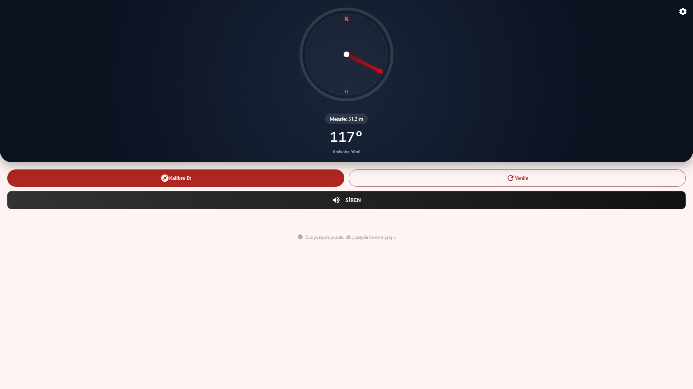
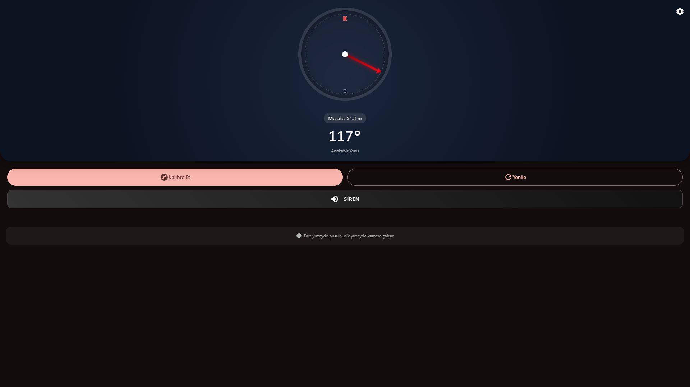
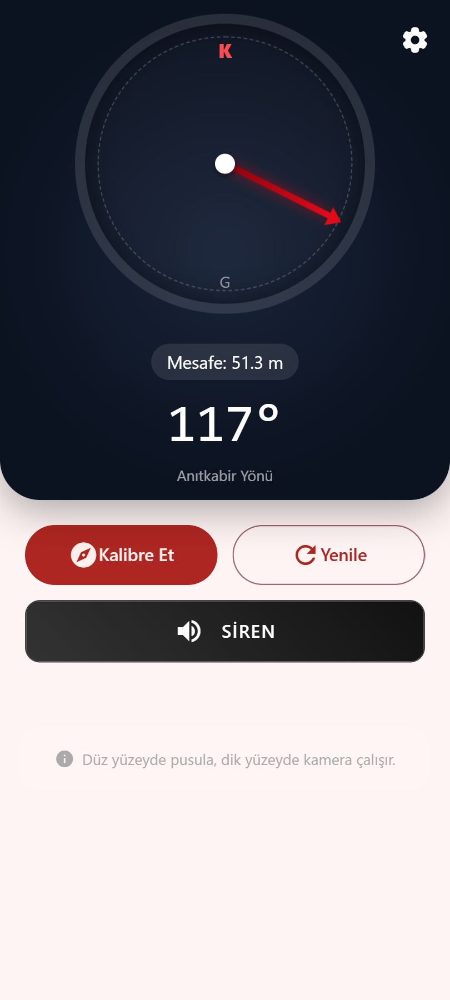
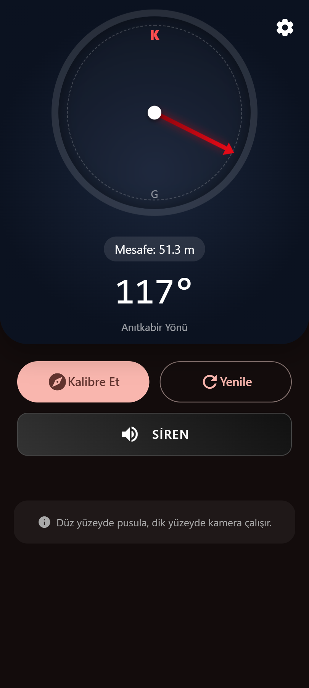

#  Anıtkabir Pusulası 

---

> [!IMPORTANT]  
> This project belongs to the FOSS community and will not be further developed by its individual developer.

[Turkish Version](README.tr.md)

This app is a compass app that shows the location of Anıtkabir (the mausoleum of Atatürk).

---

## Key Feature

**Compass pointing to Anıtkabir**

### Modes

- Compass
- Camera
- Controls (split view/landscape mode)

### Other Features

- Play Siren
- Debug Utilities (Development/Beta only) + [Eruda](https://github.com/liriliri/eruda) DevTools

---

## App

### Permissions

- **Geolocation**: To calculate the direction and distance to the target.
- **_Camera_**: To use camera mode
- (**_Motion Sensors/Orientation_**: To calculate the direction to the target according to device orientation)

## [Requirements](REQUIREMENTS.md)

^

## [Installing/Building](BUILD.md)

^

## Tech Stack

- [Node.js](https://nodejs.org)
- [Capacitor](https://capacitorjs.com/)
- [Framework7](https://framework7.io/)
- [WebAPI (Webview)](https://developer.mozilla.org/en-US/docs/Web/API)

# Information Needs Attention!

> **[Enblox (Individual)](https://github.com/EnbloxC3)**: This project is an old one that I've had for about a year. Actually, this app was a joke I saw on the internet around the time I published this repository a year ago. I saw a stupid app called Anıtkabir Compass (Anıtkabir Pusulası) paid on the App Store, and I bet I would make a more advanced version of that app for free and open source. About 2 weeks later, I make a draft application working on Web and started to do the rest of app from there. Another week later, I experienced BADLY compatibility issues with Capacitor, ragequited, and abandoned the project and forgot about it. One year later, 3 weeks ago from today (the day I published the repository), while looking for a project to work on, I found this and thought, why not start again? I revival the app back in a 3 week development and maintenance process. However, since I no longer want to struggle with this project, I am overing all of these with its errors, vulnerabilities, and problems any further and I am pushing it. **ALSO:** I didnt create Capacitor iOS platform because i dont have Apple Products (iOS app creating, testing and runnnig needs Apple Products its NOT subjective preference)

## Note

> This project is a student project; besides its main theme, the primary goal is to test how closely native applications can be created using this technology stack, and how to utilize Framework7, the most significant dependency in this stack.

### Total Point of Tech Stack as Experienced

**`10/6`** 
Spiritual value of the project theme: +3 
Fun project: +1 
Actually useless technologies for project: -1 
Cross Platform: +1 
Unstable development enviorment for me: -1 
Native hardness: -1 
Learning: +2 
First steps of my own architectures: +2 

---

# Preview

---

---

<!-- Repo Info -->

<!-- same origin push test -->
